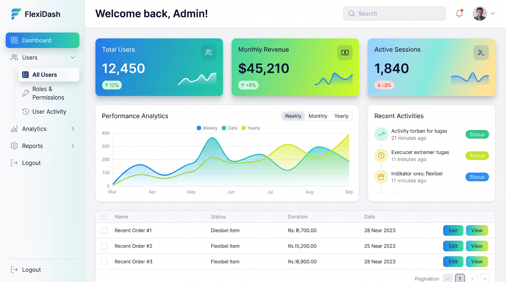

# Filament Custom Dashboard

Berikut adalah pratinjau dari desain dashboard Filament kustom dengan mode terang (light mode) dan warna gradasi biru, hijau, kuning, lengkap dengan sub-menu.

## Ringkasan Fitur Desain:
* **Tema:** Terang (Light Mode) yang bersih dan ramah pengguna.
* **Skema Warna:** Aksen gradasi halus menggunakan perpaduan warna biru, hijau, dan kuning yang menyegarkan mata.
* **Navigasi (Sidebar):** Struktur hierarki menggunakan Sub-menu yang rapi dan terorganisir (contoh: pada menu *Users* terdapat sub-menu *All Users*, *Roles & Permissions*, dan *User Activity*).
* **Komponen Utama:** 
  * Widget statistik utama di bagian atas (Total Users, Monthly Revenue, Active Sessions).
  * Grafik analitik performa yang mulus.
  * Log aktivitas terbaru.
  * Tabel data dengan fitur status, paginasi, dan tombol aksi (Edit/View).