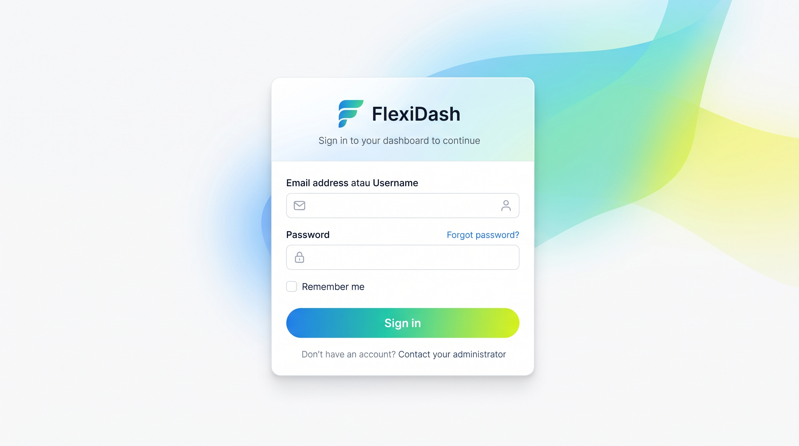

# Filament Custom Login Page

Berikut adalah pratinjau dari desain halaman login yang selaras dengan tema dashboard, menggunakan gaya yang bersih dan modern.

## Ringkasan Fitur Desain:
* **Tema Visual:** Konsisten dengan mode terang (Light Mode) pada dashboard utama.
* **Latar Belakang (Background):** Menggunakan elemen grafis gelombang abstrak dengan gradasi warna biru, hijau, dan kuning yang lembut untuk memberikan kesan dinamis namun tidak mengganggu fokus.
* **Komponen Form:**
  * Berada di dalam kartu (card) berwarna putih bersih dengan efek bayangan (shadow) halus untuk kedalaman visual.
  * Input field yang minimalis dengan ikon pendukung.
  * Tombol "Sign in" yang mencolok menggunakan gradasi warna utama (biru ke hijau-kuning) sebagai *Call to Action* (CTA).
  * Tautan tambahan seperti "Forgot password?" dan informasi kontak administrator di bagian bawah.