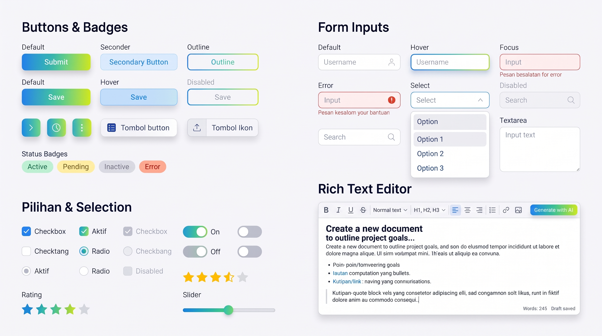

# Filament Custom UI Components Kit

Berikut adalah pratinjau dari kumpulan komponen antarmuka pengguna (UI Components) yang selaras dengan tema terang (Light Mode) dashboard, dilengkapi dengan berbagai elemen interaktif dan editor dokumen.

## Ringkasan Komponen:
* **Tema Visual:** Menggunakan gaya desain yang bersih dengan latar belakang putih/abu-abu terang dan aksen warna gradasi (biru, hijau, kuning) yang konsisten dengan sistem desain utama.
* **Buttons & Badges:** 
  * Tombol aksi dengan berbagai variasi gaya: *Default (Solid)*, *Secondary*, *Outline*, dan *Disabled*.
  * Tombol dengan ikon pendukung.
  * Indikator status (Badges) dengan warna semantik: *Active* (Hijau), *Pending* (Kuning), *Inactive* (Abu-abu), dan *Error* (Merah).
* **Form Inputs:** 
  * Input teks dengan berbagai state interaktif: *Default*, *Hover*, *Focus*, dan *Error* (dengan pesan validasi).
  * Komponen *Select Dropdown* dengan opsi yang rapi.
  * *Textarea* standar untuk input teks multabaris.
* **Pilihan & Selection:** 
  * Elemen formulir interaktif seperti *Checkbox* dan *Radio Button* (dengan state *Checked/Unchecked/Disabled*).
  * *Toggle Switch* (On/Off).
  * *Rating stars* dan *Slider* interaktif.
* **Rich Text Editor (Dokumen):** 
  * Area input teks kaya (WYSIWYG) untuk kebutuhan dokumen.
  * *Toolbar* lengkap untuk pemformatan teks (Bold, Italic, Underline, Heading, Alignment, Lists, Link, Image).
  * Dilengkapi dengan tombol aksi spesial bergradasi "Generate with AI" untuk fitur cerdas tambahan.